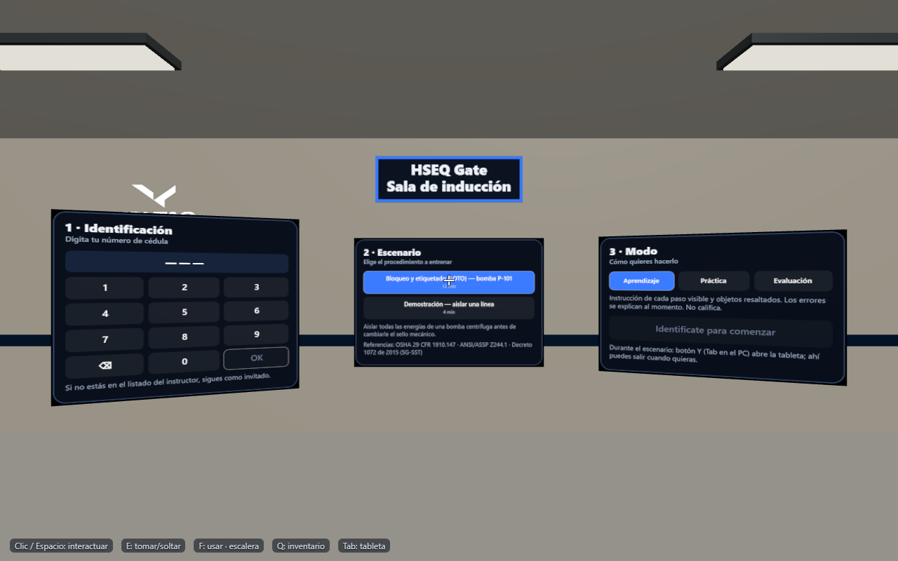
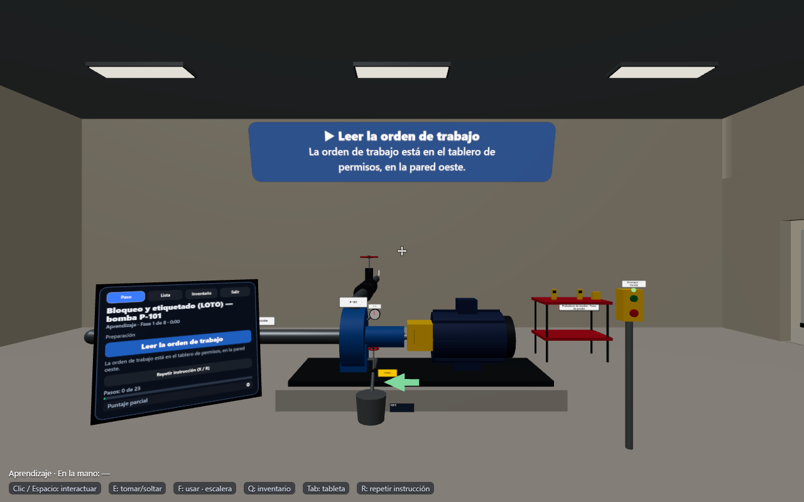
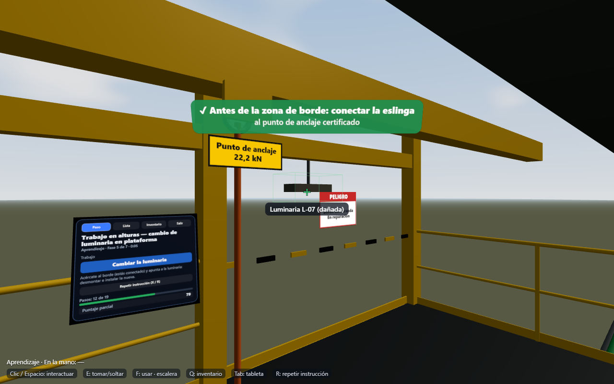
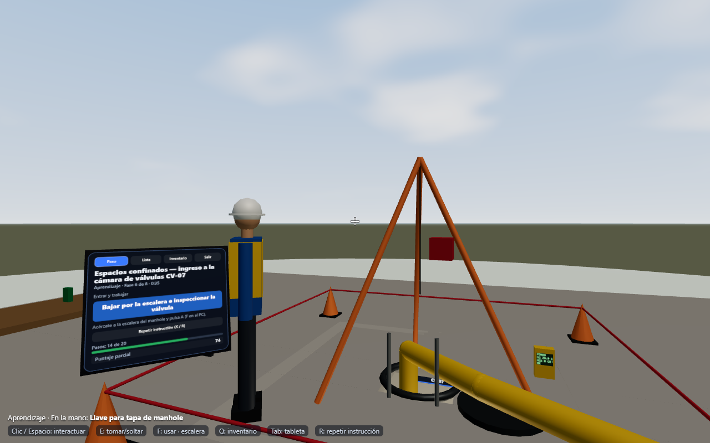
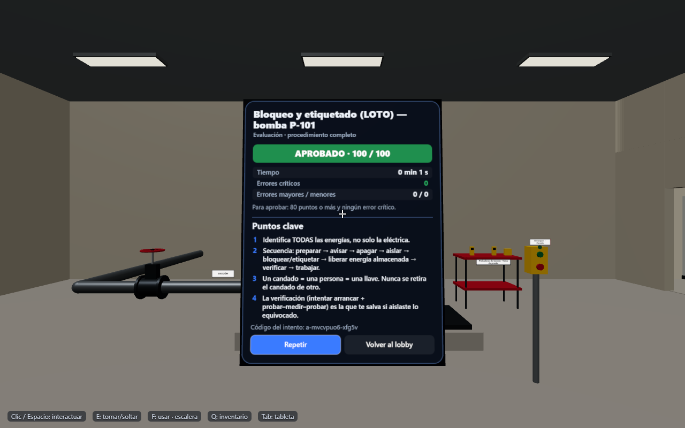
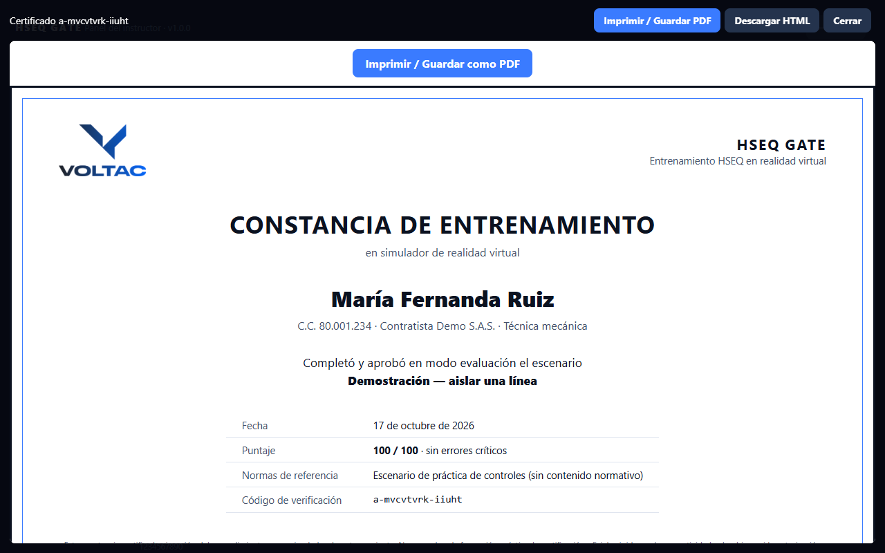

# HSEQ Gate

Entrenamiento inmersivo de seguridad industrial en realidad virtual para Meta Quest 3S — Voltac Systems S.A.S.
Versión **1.0.0**.

La persona entra a un entorno industrial a escala real y ejecuta, paso a paso, procedimientos críticos de
seguridad: bloqueo y etiquetado de energías (LOTO), trabajo en alturas e ingreso a espacios confinados. El
sistema guía, corrige, detecta errores críticos (con su consecuencia simulada) y evalúa. Así se hace inducción
y reentrenamiento **sin exponer a nadie en campo**.

| Lobby (sala de inducción) | LOTO — bomba P-101 | Alturas — borde sin baranda |
|---|---|---|
|  |  |  |
| **Espacios confinados — cámara CV-07** | **Debrief** | **Certificado** |
|  |  |  |

## Qué incluye
- **3 escenarios completos** (LOTO, alturas, espacios confinados) + un escenario corto de demostración de
  controles, cada uno en modo **Aprendizaje** (guía y resaltado), **Práctica** (pistas que cuestan puntos) y
  **Evaluación** (sin ayudas; un crítico termina el intento).
- **Motor de escenarios por datos** (`app/src/engine/`): un escenario nuevo es un archivo de datos
  (`app/src/scenarios/*.js`) + su entorno procedural (`app/src/world/<id>/`). Umbrales en un solo archivo:
  `app/src/scenarios/limits.js` (`// VALIDAR HSE`).
- Errores críticos con **consecuencia simulada** confortable (arranque inesperado, chorro de agua caliente,
  caída sin rotar la cámara, desvanecimiento) y explicación.
- **Registros locales** (IndexedDB), **panel del instructor** (aprendices CSV, resultados, exportar/importar
  JSON y CSV, eliminar datos de una persona) y **certificado imprimible** con código de verificación.
- PWA que funciona **sin conexión** y proyecto de **APK inmersivo** para Quest preparado (`quest-apk/`).

## Probarlo en 5 minutos
```
cd app
npm install
npm run build
npm run preview -- --mode plain --port 4180
```
Abrir `http://localhost:4180/hseq/` → **Recorrer en el PC**: W A S D caminar, ratón mirar, clic / Espacio
interactuar, E tomar/soltar, F usar objeto o escalera, Q siguiente objeto, Tab tableta, R repetir instrucción.
En el lobby: digita una cédula y OK, elige escenario y modo, **Comenzar**.

En el visor: abrir la URL publicada en el navegador de Meta Quest → **Entrar en realidad virtual** (o el APK,
que entra solo). Stick izquierdo camina, derecho gira (adelante y soltar = teletransporte), gatillo interactúa,
grip toma, A usa, B inventario, X repite la instrucción, Y tableta.

## Pruebas
```
cd app
npm test                 # 86 pruebas: motor, cada escenario (camino feliz + cada crítico + semillas), registros
npm run smoke            # Edge headless: lobby, los 3 escenarios en los 3 modos, críticos, panel, certificado, offline
node tests/emu.mjs       # entra a VR con el emulador IWER (puerto 5174)
node tests/emu-flow.mjs  # VR emulado: lobby → escenario
node tests/leak.mjs      # diagnóstico: memoria de GPU estable entre escenarios
```
Rendimiento medido (vista más cargada de cada escenario, presupuesto Quest 3S ≤ 90 llamadas / ≤ 250 k triángulos):
LOTO 27 llamadas · 5,5 k triángulos; Alturas 13 · 7,7 k; Confinados 27 · 6,3 k.

## Documentación
| Doc | Contenido |
|---|---|
| [CLAUDE.md](CLAUDE.md) | Instrucciones y protocolo autónomo para el asistente |
| [ESTADO.md](ESTADO.md) | Bitácora, decisiones, **resumen de revisión** y lo que falta |
| [docs/00-vision.md](docs/00-vision.md) | Propósito, usuarios, alcance del MVP |
| [docs/01-arquitectura-y-reuso.md](docs/01-arquitectura-y-reuso.md) | Stack y qué se toma de Smart Plant 3D |
| [docs/02-motor-de-escenarios.md](docs/02-motor-de-escenarios.md) | Formato de escenarios, pasos, errores, puntaje |
| [docs/03-escenario-loto.md](docs/03-escenario-loto.md) | Escenario 1: bloqueo y etiquetado de una bomba |
| [docs/04-escenario-alturas.md](docs/04-escenario-alturas.md) | Escenario 2: trabajo en alturas en estructura |
| [docs/05-escenario-espacios-confinados.md](docs/05-escenario-espacios-confinados.md) | Escenario 3: ingreso a un foso |
| [docs/06-ux-vr.md](docs/06-ux-vr.md) | Interacción, paneles, comodidad, lobby |
| [docs/07-evaluacion-y-registros.md](docs/07-evaluacion-y-registros.md) | Modos, puntaje, resultados, certificados |
| [docs/08-plan-de-etapas.md](docs/08-plan-de-etapas.md) | Etapas 0–9 con criterios de terminado |
| [docs/09-calidad-pruebas-rendimiento.md](docs/09-calidad-pruebas-rendimiento.md) | Pruebas automáticas y presupuesto de rendimiento |
| [docs/10-despliegue-y-apk.md](docs/10-despliegue-y-apk.md) | Web, PWA, APK y canal ALPHA (pasos del dueño) |
| [docs/11-backlog-escenarios.md](docs/11-backlog-escenarios.md) | Escenarios futuros |

## Aviso
El contenido de seguridad es material de entrenamiento y **debe ser validado por un profesional HSE**
antes de usarse como formación oficial. Los umbrales y pasos se configuran en un solo archivo.
